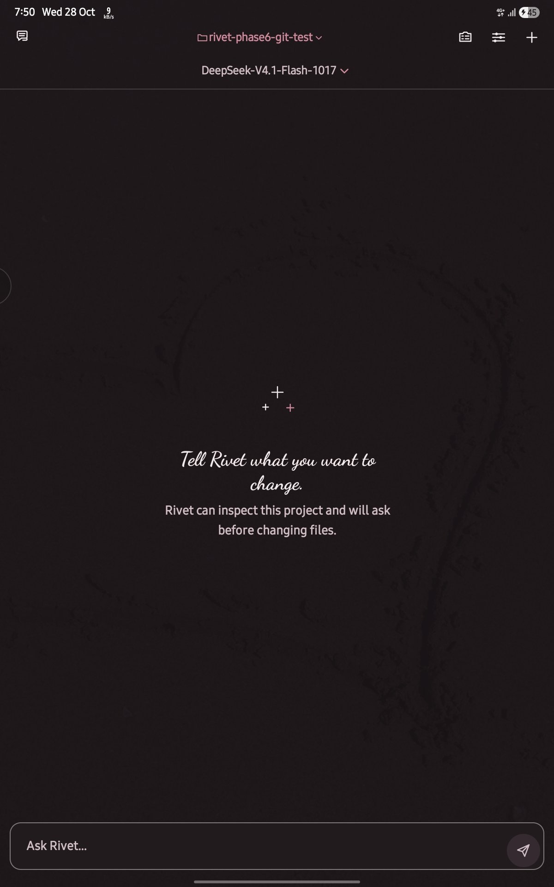
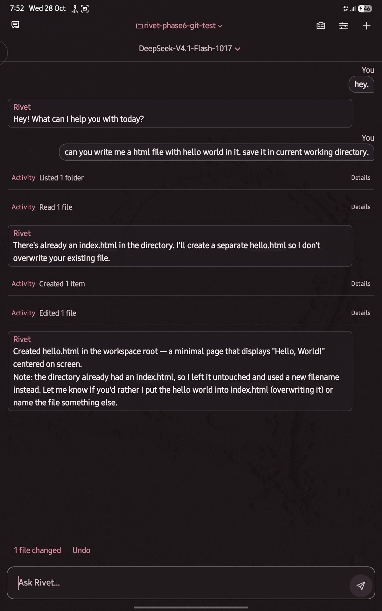
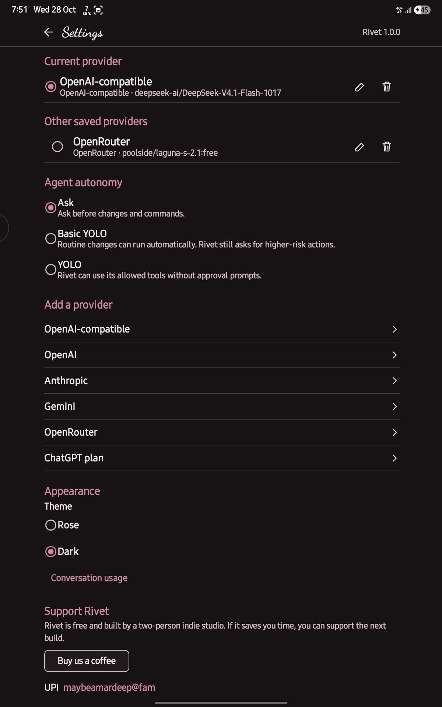

# Rivet

**Code with AI, right on your Android phone.**

No laptop. No Termux setup. Pick a project folder, pick a model, tell Rivet
what to change. It reads your files, makes the edits, runs the commands —
and asks first, if you want it to.

[](https://github.com/Kaiser0733/rivet/releases/latest)
[](https://github.com/Kaiser0733/rivet/releases/latest)
[](LICENSE)

**[⬇ Download the latest APK](https://github.com/Kaiser0733/rivet/releases/latest)** · [Support the build](https://www.buymeacoffee.com/Vastraalabs)

Built by [Vastraa Labs](https://vastraalabs.online). Two people, no investors.

## See it

https://github.com/user-attachments/assets/b83108c7-88a5-41f8-a440-a76f53d872a5

<p>
  
  
  
</p>

Left to right: ask for a change, watch it work, set it up your way.

## What it does

- Reads, searches, edits, and creates files in the folder you pick.
- Runs commands on the phone. You see them live and can stop them.
- Messed up? Undo takes it back. Checkpoints keep it safe.
- Switch provider, model, or thinking level mid-chat. No restart.
- Thinking levels from Default to Max, where the provider allows it.
- Three modes: **Ask** (asks before everything), **Basic YOLO** (small stuff
  runs on its own), **YOLO** (no prompts).
- Reads `AGENTS.md` in your project, so your rules stick.
- Previews web projects on the phone.
- Rose and Dark themes.

## Providers

Bring your own key: OpenAI, Anthropic, Gemini, OpenRouter, or any
OpenAI-compatible API. You can also sign in with a ChatGPT plan.

Your key stays on your phone, encrypted. We never see it.

## What you need

- Android 8 or newer.
- Internet, for the model.
- Your own API key. Your provider may charge you. Rivet doesn't.

## Install

Download the APK from [Releases](https://github.com/Kaiser0733/rivet/releases/latest)
and open it. Android will ask if that's okay — it does that for every app
outside the Play Store.

## Updates

In the app: **Settings → Check for updates**. Rivet downloads the new APK,
checks it's really ours, and saves it to Downloads. You tap it to install.
Nothing installs on its own.

## The honest part

- Rivet only touches the folder you pick. It can change files in it.
- Commands run like a normal app on your phone. There is no sandbox.
  Read what you approve.
- Undo is not a backup. Keep your project in Git or copied somewhere safe.
- Text edits work on files up to 1 MB.

More in [SECURITY.md](SECURITY.md).

## Build it yourself

You need JDK 17, Android SDK 35, and NDK 27.2.12479018.

```sh
./gradlew assembleDebug
```

CI builds and checks every change. Release signing steps are in
[RELEASE_PROCESS.md](RELEASE_PROCESS.md).

## Support

Rivet is free. If it saved you time, help the next build happen:

- [Buy us a coffee](https://www.buymeacoffee.com/Vastraalabs)
- UPI: `maybeamardeep@fam`

## License

Apache-2.0. Parts we borrowed keep their own licenses — see
[THIRD_PARTY_NOTICES.md](THIRD_PARTY_NOTICES.md). Rivet is not part of Termux.
